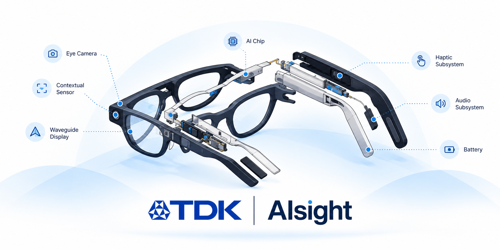

# Building the Future of AI Glasses

We develop the fundamental technologies that enable AI glasses to connect people with generative AI in a personal and natural way.

By combining custom chips, cameras, sensors, and highly efficient AI software, we build integrated systems for context-aware vision, eye tracking, eye intent, and low-power on-device intelligence.

[Website](https://aisight.tdk.com/) ·
[Videos](https://aisight.tdk.com/resources-videos) ·
[LinkedIn](https://www.linkedin.com/company/tdkaisight) ·
[Careers](https://aisight.tdk.com/careers) ·
[News](https://aisight.tdk.com/resources-news) ·
[Contact](mailto:aisight-contact@tdk.com)

 

## See AIsight in action

- [AIsight CES 2026 — Full Presentation Walkthrough](https://www.youtube.com/watch?v=Xj85iUnJSaw)
- [SoftEye Functional Demo](https://www.youtube.com/watch?v=B45pwKm3eQk)
- [TDK CEO discusses the future of smart glasses](https://www.youtube.com/watch?v=aG5aENxnL9E)
- [Explore more AIsight videos](https://aisight.tdk.com/resources-videos)

 

## Featured

- [Physical AI Augments Human Perception, Transforming Smart Glasses into Action Partners](https://www.tdk.com/en/featured_stories/entry_087-AI-glasses-TDK-AIsight.html)
- [AI Integrated XR/Smart Glasses and the Next Human-Machine Interface](https://www.youtube.com/watch?v=8vj-e78ehg0)
- [Smart Glasses & AR/VR — TDK sensing technologies](https://www.invensense.tdk.com/en-us/smart-glasses)

 

## Latest news

- **August 18, 2026** — [TDK acquires OQmented assets to strengthen AR display technology](https://www.tdk.com/en/news_center/press/20260818_01.html)
- **January 6, 2026** — [TDK launches AIsight and introduces the SED0112 ultra-low-power DSP for AI glasses](https://www.tdk.com/en/news_center/press/20260106_01.html)
- **June 19, 2025** — [TDK acquires SoftEye to expand AI capabilities for smart glasses](https://www.tdk.com/en/news_center/press/20250619-01-acquisition-of-SoftEye.html)

 

## Join TDK AIsight

We are building the core intelligence platform for the next generation of AI-powered smart glasses.

Explore opportunities across AI/ML, embedded software, hardware, product development, and customer engineering.

[View current openings](https://aisight.tdk.com/careers)